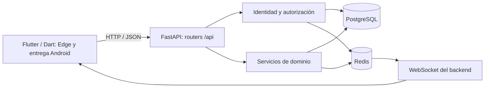

# Arquitectura del proyecto reunido

## Componentes



Flutter y FastAPI son proyectos independientes dentro del mismo repositorio.
La API es la interfaz publicada por el backend, no una tercera aplicación.
Flutter utiliza una URL; no accede directamente a las carpetas Python ni a la base.

## Mapa de carpetas

| Carpeta | Responsabilidad |
|---|---|
| `movil/lib/ui` | Pantallas y widgets |
| `movil/lib/providers.dart` | Estado y coordinación con Riverpod |
| `movil/lib/data` | Contrato de repositorio y clientes demo/API |
| `movil/lib/models` | Datos utilizados por la app |
| `movil/lib/services` | Coordinador de sesión, autenticación, WS y push preparado |
| `backend/app/main.py` | Aplicación FastAPI y registro de routers |
| `backend/app/routers` | Endpoints y validaciones de entrada |
| `backend/app/middleware` | Dependencias de identidad, permisos y controles HTTP |
| `backend/app/services` | Reglas y operaciones del dominio |
| `backend/app/schemas` | Esquemas Pydantic de entrada y respuesta |
| `backend/app/models` | Entidades SQLAlchemy |
| `backend/alembic` | Evolución versionada del esquema |
| `docker-compose.yml` | PostgreSQL, Redis, migraciones y API con volúmenes propios |

Los modelos Dart y Python representan información relacionada, pero no son
archivos compartidos: se comunican mediante contratos JSON.

## Ejemplo de comunicación: login

```text
Pantalla Flutter
    → controlador de sesión
    → ApiAuthService / ApiClient / Dio
    → POST /api/auth/login
    → router FastAPI
    → consulta de usuario y verificación de contraseña
    → respuesta HTTP con access token y cookie de refresh
    → consulta de /api/auth/me
    → actualización del estado y navegación móvil
```

Este flujo está implementado y comprobado en Edge. La demo utiliza su selector;
el modo API utiliza credenciales reales. Resultados en [estado actual](estado-actual.md)
y contrato en [contratos API](contratos-api.md).

## Contratos de comunicación

Los [contratos](contratos-api.md) definen credenciales, perfil, aplicaciones,
bandeja/lectura persistente, renovación, WS y logout, junto con la composición
beta completa. Decisiones y evidencia histórica en [estado actual](estado-actual.md).

- `CS_API_URL`: origen HTTP sin path; solicitudes absolutas `/api/...`.
- Roles API: ADMIN, TEAM_LEADER y DEVELOPER, con mapeo explícito en Dart.
- Sesión web: refresh por cookie HttpOnly, CSRF y access en memoria.
- Transporte navegador separado de `dart:io`; Android reutilizará el ciclo
  cookie con jar y almacenamiento protegido, probado en su plataforma final.
- WS: ticket de 15 s, nuevo por conexión, envelopes `notification/update`
  bajo `data`; controles de heartbeat/actividad y reconexión cancelable.
- Inicio API inicial con aplicaciones/notificaciones reales; ampliación beta
  compone dashboard/tablero/detalle con rutas existentes, sin dependencia BFF.
- Roles/estados/campos desconocidos se tratan según contrato; no se obtienen
  permisos, métricas o porcentajes ficticios a partir de datos ausentes.

La [matriz beta/API](matriz-beta-api.md) documenta vistas, acciones y permisos.
El [manifiesto inicial](contratos-recorrido-inicial.json) conserva 11 operaciones
HTTP cuya metadata se verificó contra OpenAPI durante la integración inicial.

## Implementación Flutter/API de etapa 8

- `ApiClient`: access privado en memoria, refresh single-flight, replay único,
  generación y revocación confirmada/pendiente. Adaptadores HTTP separados por
  imports condicionales; jar nativo actualmente en memoria.
- `ApiAuthService` y `AuthNotifier`: login/perfil/cambio/logout y máquina de
  estados (`restoring`, `signedOut`, `signingIn`, `passwordRequired`,
  `authenticated`, `signingOut`, `logoutPending`). `SessionLifecycle` desacopla
  el cierre WS; solo la marca operativa por origen se persiste en preferencias.
- `api_models.dart`: DTO de perfil/token/aplicación/notificación con tipos y
  campos estrictos; `ApiError` conserva clase/status/detalle sin secretos.
- `api_domain_models.dart`: tickets DEVELOPMENT, épicas, subtareas, eventos,
  directorio e incidentes estrictos; UUID/estados/fechas y valores nullable.
- `ApiResources`/`ApiRepository`: páginas deduplicadas, snapshot por sesión y
  revisión, aplicaciones/épicas compartidas y fan-out secuencial; métricas de
  tickets completos y `completed_at`. Mutaciones por recurso con doble envío
  bloqueado, validación de resultado e invalidación también ante respuesta ambigua.
- `HomeShell`: contenedor beta activo en demo/API, cuatro destinos para gestores
  y tres para developer, avisos/campana/Ajustes. `ApiHomeShell` queda como archivo
  histórico sin ser seleccionado. No se consulta BFF ni directorio antes del login.
- `MaterialApp` y shell identificados por usuario; `setSession` limpia cache y
  resultados pendientes; logout retira Navigator, rutas y paneles de otra sesión.
- `ApiWebSocketService`: tickets, frames, deduplicación, actividad y backoff
  cancelable; eventos invalidan providers y la reconexión resincroniza por HTTP.

La evidencia de integración, presentación e interacción está consolidada en
[estado actual](estado-actual.md). El siguiente incremento, aún en pausa, es
la matriz de requisitos de Equipo 1; cierre global y capacidades nativas
mantienen sus contratos posteriores.

## Backend y datos

La API guarda información persistente en PostgreSQL. Redis se utiliza para
revocación, rate limiting y mensajería. La actualización del cliente eliminó
ARQ de las dependencias y publica las notificaciones directamente desde la API.
El worker ARQ no forma parte del arranque actual; su archivo documental se retiró.

Esta copia utiliza Docker Engine en Ubuntu/WSL2. Compose inicia PostgreSQL 15,
Redis 7 y FastAPI. Sus datos se mantienen en volúmenes propios del proyecto.
El backend utiliza `postgres:5432` y `redis:6379` dentro de la red de Compose.

Las migraciones Alembic se ejecutan en el servicio `migrate` antes de FastAPI.
La API se publica en Windows en el puerto 8001. Para documentos se utiliza
`STORAGE_BACKEND=local` en desarrollo y GCS en el despliegue del cliente.

## Plataformas Flutter

La aplicación está centralizada en `movil/`, manteniendo el nombre del paquete
Dart `corestream_mobile`. Se prepara primero `movil/web/` para trabajar en Edge.
`movil/android/` se genera con Flutter en la etapa final, antes de configurar,
compilar y validar la entrega Android. No se genera iOS.

## Lecturas optimizadas para móvil

La especificación pide endpoints BFF bajo `/mobile` para dashboard, tablero,
detalle y carga del equipo. Un BFF compone respuestas usando el dominio común;
no requiere otra base ni otro motor de reglas.

El paquete `mobile_api` no forma parte del backend disponible. La ampliación
acordada prioriza las rutas existentes y realiza composición en Flutter:
aplicaciones → épicas con DEVELOPMENT; incidentes → `/api/incidents/`;
Equipo → usuarios autorizados y asignaciones. SUPPORT conserva su propio
dominio. No se equipara `/api/teams` a carga de trabajo. La
[matriz beta/API](matriz-beta-api.md) registra permisos y capacidades ausentes;
un BFF optimizado sigue como objetivo documental externo, no como bloqueo local.

## Arquitectura SaaS solicitada

La autorización completa debe considerar:

1. Sesión válida.
2. Empresa (`client_id`) del usuario y del recurso.
3. Función habilitada por el plan comercial.
4. Rol y permisos sobre el recurso.
5. Compatibilidad de la acción con el estado de negocio.

Los requisitos de multi-tenancy, feature gating y auditoría ampliada describen
capacidades objetivo. No deben confundirse con capacidades ya implementadas
por haber copiado el backend.

El historial de un ticket y el logging JSON existente no equivalen por sí solos
a un repositorio inmutable de auditoría con retención comercial y exportación.

## Coordinación de equipos

| Equipo | Responsabilidad asignada |
|---|---|
| 1 | Sesión, dispositivos, push, 2FA/SSO, biometría y coordinación de seguridad/plataforma |
| 2 | Proyectos, tickets, dashboard, búsqueda, offline y coordinación de escalabilidad |
| 3 | Incidencias, carga del equipo, idiomas, ajustes, SLA y reportes |

APP-03 del Equipo 1 y APP-21 del Equipo 3 comparten el mismo logout: un servicio
de sesión debe implementar su comportamiento y Ajustes debe invocarlo.

Push FCM es distinto de WebSocket. WebSocket entrega eventos durante una conexión
activa; FCM aporta entrega mediante el sistema operativo cuando la app no mantiene
esa conexión. En la beta, Firebase está desactivado y las notificaciones demo son
simuladas.
